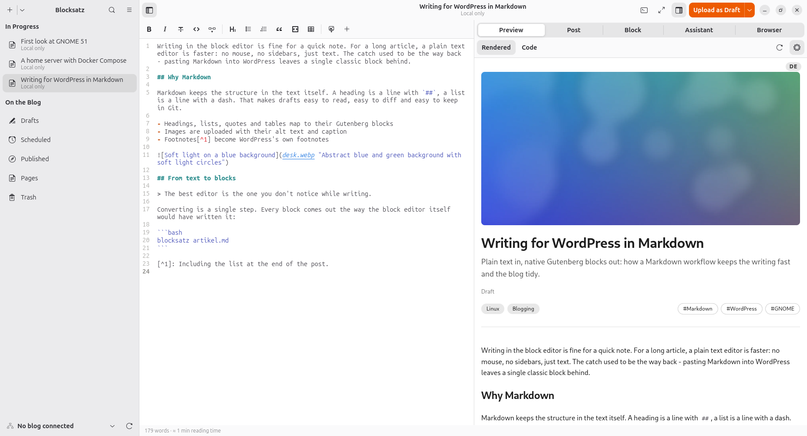
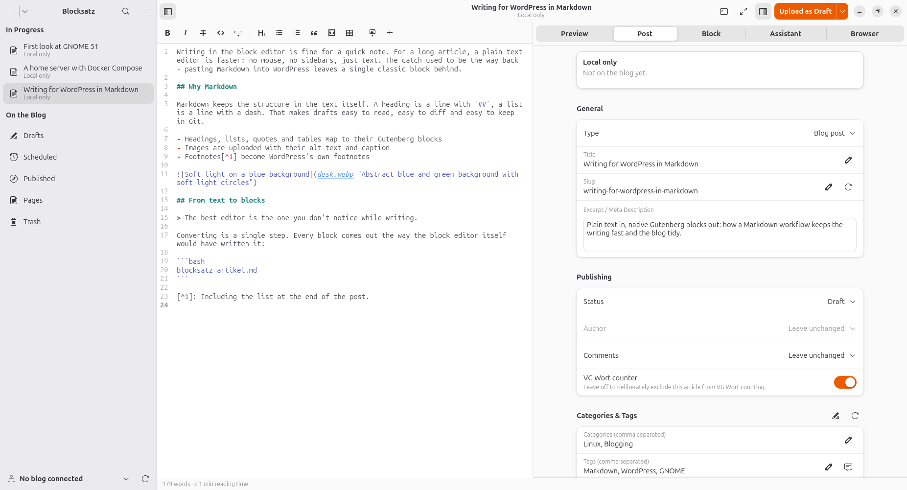
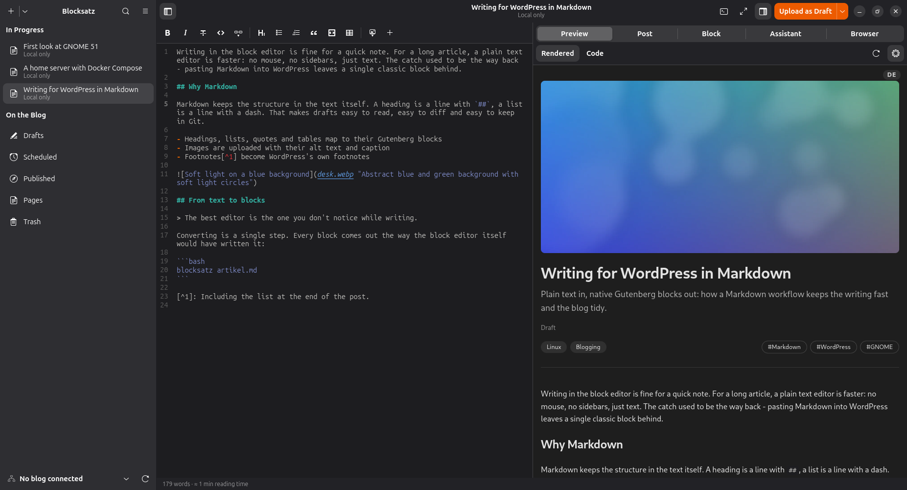

<p align="center">
  
</p>

<h1 align="center">Blocksatz</h1>

<p align="center"><strong>Write in Markdown, publish real WordPress blocks.</strong></p>

<p align="center">
  A blog editor for the GNOME desktop: plain text on the left, a live preview on the right,
  and one click turns your article into native Gutenberg blocks on your own WordPress site.
  Headings, lists, images, galleries, footnotes and tables arrive as the blocks the block
  editor itself would have written, not as one classic block full of HTML.
</p>

<p align="center">
  <a href="https://github.com/linuxundich/blocksatz/releases/latest"><strong>Download Flatpak</strong></a>
  &nbsp;·&nbsp;
  <a href="docs/FEATURES.md">All features</a>
  &nbsp;·&nbsp;
  <a href="CHANGELOG.md">Changelog</a>
</p>

<p align="center">
  
</p>

## What it does

### Markdown in, Gutenberg out

Write as you would in any text editor, with syntax highlighting, spell checking and a
formatting toolbar for the moments you'd rather click. Blocksatz converts the text into
real WordPress blocks: paragraphs, headings, lists, quotes, tables, images, videos,
embeds, footnotes and the "more" marker. Code blocks keep their language and file name
for the blog's syntax highlighting.

### More than plain Markdown

Columns, buttons, galleries, accordions, tabs, cover images, boxes and formulas are
written as short fenced blocks. Colors, sizes and alignment go into a line in curly
braces below a block, using the presets of your blog's theme. You don't have to remember
them: the *Block* view picks colors from the theme's palette, sizes and block styles for
the block under the cursor and writes the line for you.

### A preview that looks like your blog

The preview follows the editor line by line and loads the colors, gradients and font
sizes of the active blog's theme, so striped tables and colored boxes look the way they
will once published. The *Code* tab shows the exact block markup that will be sent, and
*On the Blog* shows the post as WordPress itself renders it.

### From first draft to published post

Every article lives in its own folder in your Documents, saved as you type. One button
in the header bar always says what comes next: *Upload as Draft*, *Update Draft*,
*Publish…*. Before publishing, a release check looks at the title, excerpt, categories,
tags, featured image, alt texts and links, and offers a fix for each problem it finds.
Schedule posts, edit pages as well as posts, and manage several blogs from one window.

<p align="center">
  
</p>

### Your existing posts, back as Markdown

Open any post or page from the blog and keep working on it in Markdown. Blocksatz only
turns a block into Markdown if it comes back as exactly the same block; anything Markdown
can't express stays as it was and goes back unchanged. A sync check notices when a post
was changed on the blog in the meantime and shows the differences before anything is
overwritten.

### Images without the busywork

Paste a screenshot, drop files onto the editor or pick them from the media library.
Every image gets its own alt text and caption, uploads go out as WebP at a sensible size,
and an image that is already on the blog is not uploaded twice. Convert or resize one
image or all of them at once, and drag an image's edge in the preview to set its width.

### Two languages, one article

An article and its translation sit side by side in the same folder. Switch between them
at the same paragraph, compare both versions section by section, and see what changed in
the original since you last translated it. Translate by hand, paste the result from
DeepL or a chatbot back in with code and links protected, or let an AI model do a first
draft that you review before it goes anywhere. The translation uploads to a second
WordPress site for the other language.

### Help when you want it

The assistant checks content, style, spelling and punctuation, suggests tags and writes
alt texts for your images. It works with Gemini, ChatGPT, Claude, Groq or a local Ollama
model, and nothing is sent unless you ask for it. Blocksatz works just as well with all
of this switched off.

<p align="center">
  
</p>

### Part of your GNOME desktop

- Articles from the library show up in the GNOME Shell search.
- A terminal folds out below the editor (F12) and opens in the article's folder.
- A focus mode hides everything but the text.
- The editor color schemes of GNOME Builder, light and dark mode, and a choice of
  fonts for editor and preview.
- Desktop notifications when an upload or a link check finishes in the background.
- Markdown files open from Nautilus, and new articles can start from a template there.

### Careful by default

Blocksatz never deletes a post permanently, only moves it to the WordPress trash. If
another program changes the open file, it stops saving and asks what to do. Your
WordPress password and API keys live in the system keyring, and uploads only ever change
what is sent, never your local files.

## How it works

Blocksatz is written in Rust with GTK&nbsp;4, libadwaita, GtkSourceView and WebKitGTK.
The conversion between Markdown and Gutenberg blocks lives in its own library,
[`crates/gutenberg`](crates/gutenberg), which runs without a user interface and is covered
by unit tests. Blocksatz talks to WordPress through its REST API with an
[Application Password](https://make.wordpress.org/core/2020/11/05/application-passwords-integration-guide/),
so it needs no plugin on the blog. Articles are plain Markdown files with a short header
for the post's properties, which you can read, diff and keep in Git.

## Install

1. Download `blocksatz.flatpak` from the [latest release](https://github.com/linuxundich/blocksatz/releases/latest).
2. Install it:

```sh
flatpak install --user blocksatz.flatpak
```

Flatpak fetches the GNOME 51 runtime from Flathub if it is missing. Bundles don't update
themselves, but Blocksatz tells you when a new release is out.

You need a WordPress site with the REST API enabled (the default) and an Application
Password for your user, which you create under *Users → Profile* in wp-admin. The
interface is available in English and German and follows your system language. To build
Blocksatz yourself, see [docs/BUILDING.md](docs/BUILDING.md).

## More

- [All features](docs/FEATURES.md) (the full list, including everything above) · [Changelog](CHANGELOG.md) · [Building and packaging](docs/BUILDING.md)
- Background: [translations for a linked blog](docs/translations.md), [block design in Markdown](docs/markdown-blocks.md) (German)
- Found a bug or have an idea? [Open an issue](https://github.com/linuxundich/blocksatz/issues)

## Use of AI

Blocksatz is AI-assisted. Most of the code, the icon and the documentation were written
with AI assistance, directed by me: I set the requirements, made the design decisions,
reviewed the results and use Blocksatz every day to write for my blog
[Linux und Ich](https://linuxundich.de/). Commits written with AI assistance carry a
`Co-Authored-By` line.

Blocksatz is free software under the [GPL-3.0-or-later](LICENSE). The bundled editor color
schemes come from [GNOME Builder](https://gitlab.gnome.org/GNOME/gnome-builder), see
[data/style-schemes](data/style-schemes/ATTRIBUTION.md).
